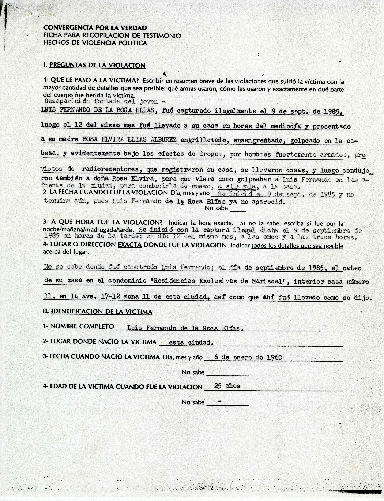
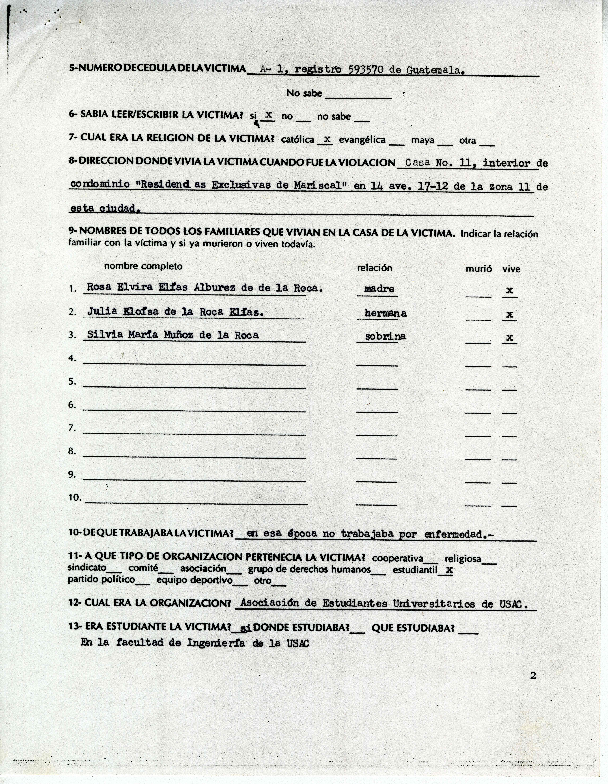
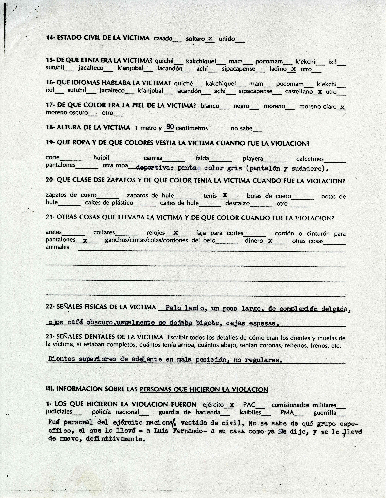
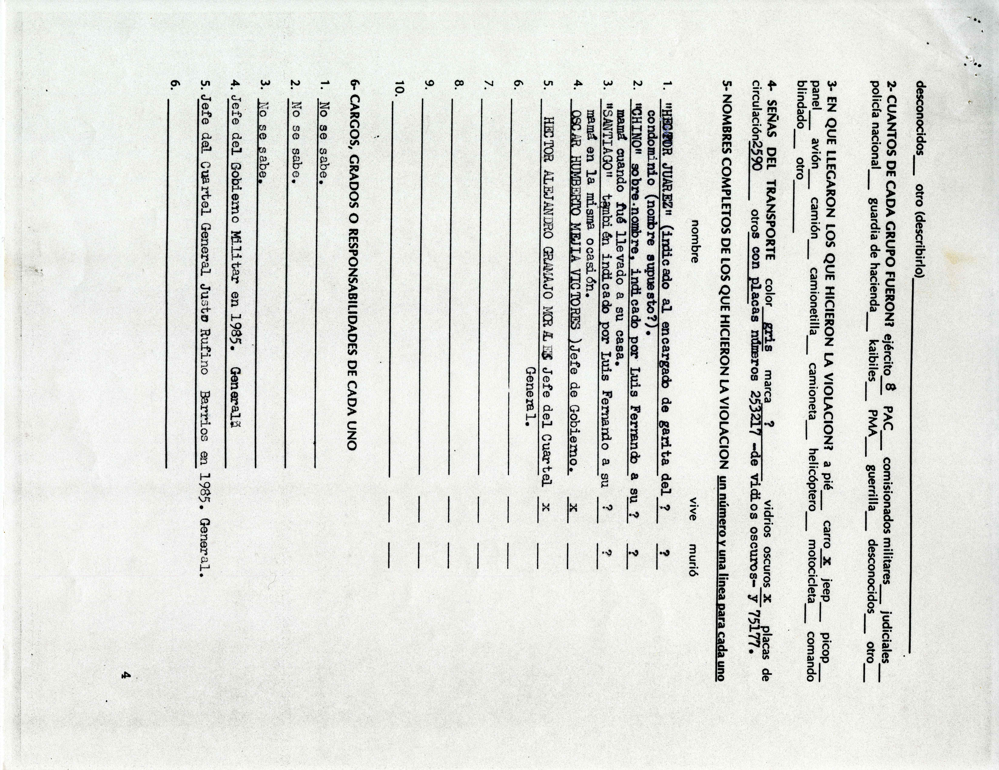
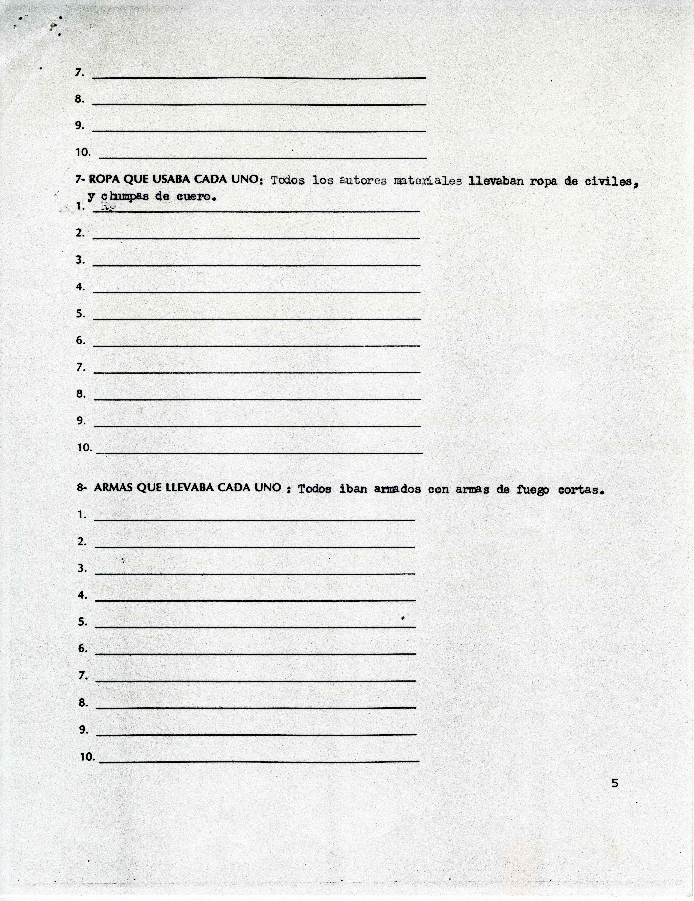
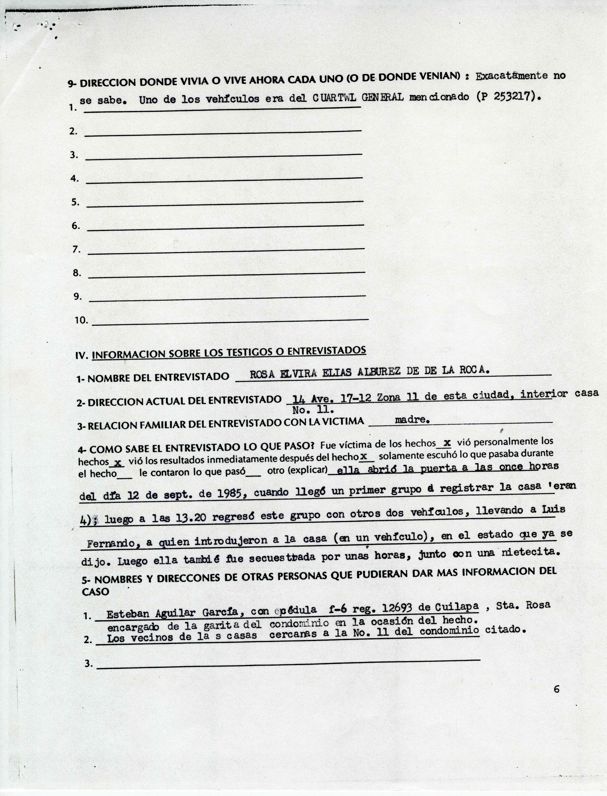
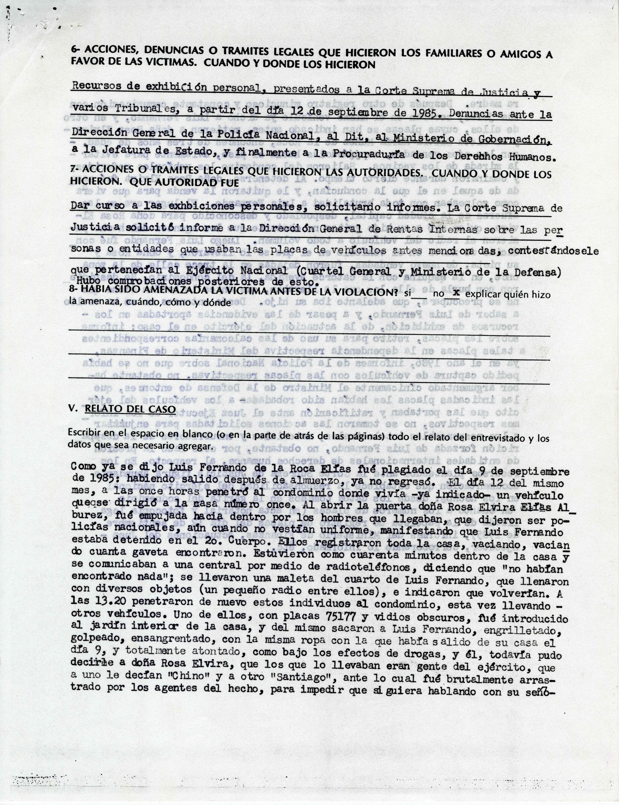
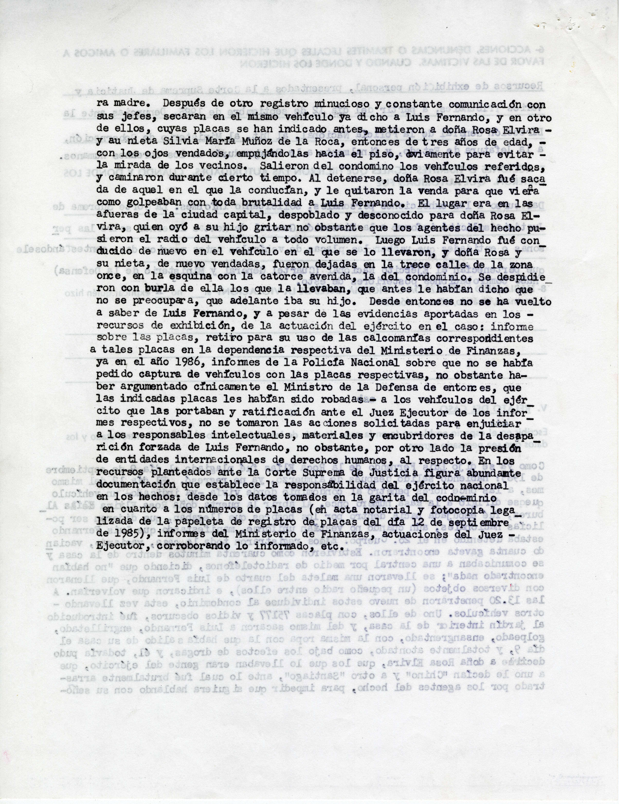

# Convergencia por la Verdad — Ficha para recopilación de testimonio

Caso: des_001_005_012 — Luis Fernando de la Roca Elías

Páginas 3–10a de la carpeta (8 imágenes). Transcripción automática (htr_v2, qwen3.6-27b), sin revisión humana.

## Página 1 de 8 — 003.jpg

CONVERGENCIA POR LA VERDAD
FICHA PARA RECOPILACION DE TESTIMONIO
HECHOS DE VIOLENCIA POLITICA

I. PREGUNTAS DE LA VIOLACION

1- QUE LE PASO A LA VICTIMA? Escribir un resumen breve de las violaciones que sufrió la víctima con la mayor cantidad de detalles que sea posible: qué armas usaron, cómo las usaron y exactamente en qué parte del cuerpo fue herida la víctima.
Desaparición forzada del joven -
LUIS FERNANDO DE LA ROCA ELIAS, fué capturado ilegalmente el 9 de sept. de 1985,
luego el 12 del mismo mes fué llevado a su casa en horas del mediodía y presentado
a su madre ROSA ELVIRA ELIAS ALBUREZ engrilletado, ensangrentado, golpeado en la cabeza, y evidentemente bajo los efectos de drogas, por hombres fuertemente armados, provistos de radioreceptores, que registraron su casa, se llevaron cosas, y luego condujeron también a doña Rosa Elvira, para que viera como golpeaban a Luis Fernando en las afueras de la ciudad, para conducirla de nuevo, a ella sola, a la casa.
2- LA FECHA CUANDO FUE LA VIOLACION Día, mes y año Se inició el 9 de sept. de 1985 y no termina aún, pues Luis Fernando de la Roca Elías ya no apareció.
No sabe ____

3- A QUE HORA FUE LA VIOLACION? Indicar la hora exacta. Si no la sabe, escriba si fue por la noche/mañana/madrugada/tarde. Se inició con la captura ilegal dicha el 9 de septiembre de 1985 en horas de la tarde; el día 12 del mismo mes, a las once y a las trece horas.
4- LUGAR O DIRECCION EXACTA DONDE FUE LA VIOLACION Indicar todos los detalles que sea posible acerca del lugar.

No se sabe donde fué caputrado Luis Fernando; el día de septiembre de 1985, el cateo de su casa en el condominio "Residencias Exclusivas de Mariscal", interior casa número 11, en 14 ave. 17-12 zona 11 de esta ciudad, así como que ahí fué llevado como se dijo.

II. IDENTIFICACION DE LA VICTIMA

1- NOMBRE COMPLETO Luis Fernando de la Roca Elías.
2- LUGAR DONDE NACIO LA VICTIMA esta ciudad.
3- FECHA CUANDO NACIO LA VICTIMA Día, mes y año 6 de enero de 1960
No sabe _________
4- EDAD DE LA VICTIMA CUANDO FUE LA VIOLACION 25 años
No sabe --

1

## Página 2 de 8 — 004.jpg

5-NUMERO DE CEDULA DE LA VICTIMA A- 1, registro 593570 de Guatemala.
No sabe :

6- SABIA LEER/ESCRIBIR LA VICTIMA? si x no no sabe

7- CUAL ERA LA RELIGION DE LA VICTIMA? católica x evangélica maya otra

8-DIRECCION DONDE VIVIA LA VICTIMA CUANDO FUE LA VIOLACION Casa No. 11, interior de condominio "Residencias Exclusivas de Mariscal" en 14 ave. 17-12 de la zona 11 de esta ciudad.

9- NOMBRES DE TODOS LOS FAMILIARES QUE VIVIAN EN LA CASA DE LA VICTIMA. Indicar la relación familiar con la víctima y si ya murieron o viven todavía.
nombre completo relación murió vive
1. Rosa Elvira Elfas Albrez de de la Roca. madre x
2. Julia Elofsa de la Roca Elfas. hermana x
3. Silvia María Muñoz de la Roca sobrina x
4.
5.
6.
7.
8.
9.
10.

10-DE QUE TRABAJABA LA VICTIMA? en esa época no trabajaba por enfermedad.-

11- A QUE TIPO DE ORGANIZACION PERTENECIA LA VICTIMA? cooperativa religiosa sindicato comité asociación grupo de derechos humanos estudiantil x partido político equipo deportivo otro

12- CUAL ERA LA ORGANIZACION? Asociación de Estudiantes Universitarios de USAC.

13- ERA ESTUDIANTE LA VICTIMA? si DONDE ESTUDIABA? QUE ESTUDIABA?
En la facultad de Ingeniería de la USAC

2

## Página 3 de 8 — 005.jpg

14- ESTADO CIVIL DE LA VICTIMA casado__ soltero x unido__

15- DE QUE ETNIA ERA LA VICTIMA? quiché__ kakchiquel__ mam__ pocomam__ k'ekchi__ ixil__ sutuhil__ jacalteco__ k'anjobal__ lacandón__ achí__ sipacapense__ ladino x otro__

16- QUE IDIOMAS HABLABA LA VICTIMA? quiché__ kakchiquel__ mam__ pocomam__ k'ekchi__ ixil__ sutuhil__ jacalteco__ k'anjobal__ lacandón__ achí__ sipacapense__ castellano x otro__

17- DE QUE COLOR ERA LA PIEL DE LA VICTIMA? blanco__ negro__ moreno__ moreno claro x moreno oscuro__ otro__

18- ALTURA DE LA VICTIMA 1 metro y 80 centímetros no sabe__

19- QUE ROPA Y DE QUE COLORES VESTIA LA VICTIMA CUANDO FUE LA VIOLACION? corte______ huipil______ camisa______ falda______ playera______ calcetines______ pantalones______ otra ropa deportiva: pants color gris (pantalón y sudadero).

20- QUE CLASE DSE ZAPATOS Y DE QUE COLOR TENIA LA VICTIMA CUANDO FUE LA VIOLACION? zapatos de cuero______ zapatos de hule______ tenis x botas de cuero______ botas de hule______ caites de plástico______ caites de hule______ descalzo______ otro______

21- OTRAS COSAS QUE LLEVABA LA VICTIMA Y DE QUE COLOR CUANDO FUE LA VIOLACION? aretes______ collares______ relojes x faja para cortes______ cordón o cinturón para pantalones x ganchos/cintas/colas/cordones del pelo______ dinero x otras cosas______ animales _________________________________________________________

_________________________________________________________________________

_________________________________________________________________________

22- SEÑALES FISICAS DE LA VICTIMA Pelo lacio, un poco largo, de complexión delgada, ojos café obscuro, usualmente se dejaba bigote, cejas espesas.

23- SEÑALES DENTALES DE LA VICTIMA Escribir todos los detalles de cómo eran los dientes y muelas de la víctima, si estaban completos, cuántos tenía arriba, cuántos abajo, tenían coronas, rellenos, frenos, etc. Dientes superiores de adelante en mala posición, no regulares.

III. INFORMACION SOBRE LAS PERSONAS QUE HICIERON LA VIOLACION

1- LOS QUE HICIERON LA VIOLACION FUERON ejército x PAC__ comisionados militares__ judiciales__ policía nacional__ guardia de hacienda__ kaibiles__ PMA__ guerrilla__ Fue personal del ejército nacional, vestida de civil, No se sabe de qué grupo específico, el que lo llevó - a Luis Fernando- a su casa como ya se dijo, y se lo llevó de nuevo, definitivamente.

## Página 4 de 8 — 006.jpg

desconocidos otro (describirlo)
2-CUANTOS DE CADA GRUPO FUERON? ejército 8 PAC comisionados militares judiciales
policía nacional guardia de hacienda kables PMA guerrilla desconocidos otro
3-EN QUE LLEGARON LOS QUE HICIERON LA VIOLACION? a pié carro X jeep picop
panel avión camión camionetilla camioneta helicoptero motocicleta comando
blindado otro
4 SEÑAS DEL TRANSPORTE color gris marca ? vidrios oscuros X placas de
circulación 2590 otros con placas numeros 253217 -de vidrios osuros- y 75177.
5-NOMBRES COMPLETOS DE LOS QUE HICIERON LA VIOLACION un número y una linea para cada uno
nombre vive murió
1. "HECTOR JUAREZ" (indicado al encargado de garita del ? ?
condominio (nombre supuesto?).
2. "CHINO" sobre nombre, indicado por Luis Fernando a su ? ?
marid cuando fue llevado a su casa.
3. "SAVITAGIO" tambièn indicado por Luis Fernando a su ? ?
marid en la misma ocasión.
4. OSCAR HUMBERTO MEJIA VICTORES Jefe de Gobierno. X
5. HECTOR ALEJANDRO GRANADO MORALEZ Jefe del Cuartel X
General.
6.
7.
8.
9.
10.
6-CARGOS, GRADOS O RESPONSABILIDADES DE CADA UNO
1. No se sabe.
2. No se sabe.
3. No se sabe.
4. Jefe del Gobierno Militar en 1985. General
5. Jefe del Cuartel General Justo Rufino Barrios en 1985. General.
6.
4

## Página 5 de 8 — 007.jpg

7.
8.
9.
10.

7- ROPA QUE USABA CADA UNO: Todos los autores materiales llevaban ropa de civiles,
y chumpas de cuero.
1.
2.
3.
4.
5.
6.
7.
8.
9.
10.

8- ARMAS QUE LLEVABA CADA UNO : Todos iban armados con armas de fuego cortas.
1.
2.
3.
4.
5.
6.
7.
8.
9.
10.

5

## Página 6 de 8 — 008.jpg

9- DIRECCION DONDE VIVIA O VIVE AHORA CADA UNO (O DE DONDE VENIAN): Exacatamente no
se sabe. Uno de los vehiculos era del CUARTWL GENERAL mencionado (P 253217).
1.
2.
3.
4.
5.
6.
7.
8.
9.
10.

IV. INFORMACION SOBRE LOS TESTIGOS O ENTREVISTADOS

1- NOMBRE DEL ENTREVISTADO ROSA ELVIRA ELIAS ALBUREZ DE DE LA ROCA.
2- DIRECCION ACTUAL DEL ENTREVISTADO 14 Ave. 17-12 Zona 11 de esta ciudad, interior casa
No. 11.
3- RELACION FAMILIAR DEL ENTREVISTADO CON LA VICTIMA madre.
4- COMO SABE EL ENTREVISTADO LO QUE PASO? Fue víctima de los hechos x vió personalmente los
hechos x vió los resultados inmediatamente después del hecho x solamente escuchó lo que pasaba durante
el hecho le contaron lo que pasó otro (explicar) ella abrió la puerta a las once horas
del día 12 de sept. de 1985, cuando llegó un primer grupo a registrar la casa 'eran
4); luego a las 13.20 regresó este grupo con otros dos vehículos, llevando a Luis
Fernando, a quien introdujeron a la casa (en un vehículo), en el estado que ya se
dijo. Luego ella también fue secuestrada por unas horas, junto con una nietecita.
5- NOMBRES Y DIRECCIONES DE OTRAS PERSONAS QUE PUDIERAN DAR MAS INFORMACION DEL
CASO
1. Esteban Aguilar Garcia, con cédula f-6 reg. 12693 de Cuilapa , Sta. Rosa
encargado de la garita del condominio en la ocasión del hecho.
2. Los vecinos de las casas cercanas a la No. 11 del condominio citado.
3.

6

## Página 7 de 8 — 009a.jpg

6- ACCIONES, DENUNCIAS O TRAMITES LEGALES QUE HICIERON LOS FAMILIARES O AMIGOS A FAVOR DE LAS VICTIMAS. CUANDO Y DONDE LOS HICIERON

Recursos de exhibición personal, presentados a la Corte Suprema de Justicia y varios Tribunales, a partir del día 12 de septiembre de 1985. Denuncias ante la Dirección General de la Policía Nacional, al Dit, al Ministerio de Gobernación, a la Jefatura de Estado, y finalmente a la Procuraduría de los Derechos Humanos.
7- ACCIONES O TRAMITES LEGALES QUE HICIERON LAS AUTORIDADES. CUANDO Y DONDE LOS HICIERON. QUE AUTORIDAD FUE

Dar curso a las exhibiciones personales, solicitando informes. La Corte Suprema de Justicia solicitó informe a la Dirección General de Rentas Internas sobre las personas o entidades que usaban las placas de vehículos antes mencionadas, contestándosele que pertenecían al Ejército Nacional (Cuartel General y Ministerio de la Defensa) Hubo comprobaciones posteriores de esto.
8- HABIA SIDO AMENAZADA LA VICTIMA ANTES DE LA VIOLACION? sí no X explicar quién hizo la amenaza, cuándo, cómo y dónde

V. RELATO DEL CASO

Escribir en el espacio en blanco (o en la parte de atrás de las páginas) todo el relato del entrevistado y los datos que sea necesario agregar.

Como ya se dijo Luis Fernando de la Roca Elías fué plagiado el día 9 de septiembre de 1985; habiendo salido después de almuerzo, ya no regresó. El día 12 del mismo mes, a las once horas penetró al condominio donde vivía -ya indicado- un vehículo que se dirigió a la casa número once. Al abrir la puerta doña Rosa Elvira Elías Al- burez, fué empujada hacia dentro por los hombres que llegaban, que dijeron ser policías nacionales, aún cuando no vestían uniforme, manifestando que Luis Fernando estaba detenido en el 2o. Cuerpo. Ellos registraron toda la casa, vaciando, vacian do cuanta gaveta encontraron. Estuvieron como cuarenta minutos dentro de la casa y se comunicaban a una central por medio de radioteléfonos, diciendo que "no habían encontrado nada"; se llevaron una maleta del cuarto de Luis Fernando, que llenaron con diversos objetos (un pequeño radio entre ellos), e indicaron que volverían. A las 13.20 penetraron de nuevo estos individuos al condominio, esta vez llevando - otros vehículos. Uno de ellos, con placas 75177 y vidrios oscuros, fué introducido al jardín interior de la casa, y del mismo sacaron a Luis Fernando, engrilletado, golpeado, ensangrentado, con la misma ropa con la que había salido de su casa el día 9, y totalmente atontado, como bajo los efectos de drogas, y él, todavía pudo decirle a doña Rosa Elvira, que los que lo llevaban eran gente del ejército, que a uno le decían "Chino" y a otro "Santiago", ante lo cual fué brutalmente arras- trado por los agentes del hecho, para impedir que siquiera hablando con su seño-

## Página 8 de 8 — 010a.jpg

ra madre. Después de otro registro minucioso y constante comunicación con
sus jefes, secaran en el mismo vehículo ya dicho a Luis Fernando, y en otro
de ellos, cuyas placas se han indicado antes, metieron a doña Rosa Elvira -
y su nieta Silvia María Muñoz de la Roca, entonces de tres años de edad, -
con los ojos vendados, empujándolas hacia el piso, obviamente para evitar -
la mirada de los vecinos. Salieron del condomino los vehículos referidos,
y caminaron durante cierto tiempo. Al detenerse, doña Rosa Elvira fué saca
da de aquel en el que la conducían, y le quitaron la venda para que viera
como golpeaban con toda brutalidad a Luis Fernando. El lugar era en las
afueras de la ciudad capital, despoblado y desconocido para doña Rosa El-
vira, quien oyó a su hijo gritar no obstante que los agentes del hecho pu-
sieron el radio del vehículo a todo volumen. Luego Luis Fernando fué con-
ducido de nuevo en el vehículo en el que se lo llevaron, y doña Rosa y
su nieta, de nuevo vendadas, fueron dejadas en la trece calle de la zona
once, en la esquina con la catorce avenida, la del condominio. Se despidie
ron con burla de ella los que la llevaban, que antes le habían dicho que
no se preocupara, que adelante iba su hijo. Desde entonces no se ha vuelto
a saber de Luis Fernando, y a pesar de las evidencias aportadas en los -
recursos de exhibición, de la actuación del ejército en el caso: informe
sobre las placas, retiro para su uso de las calcomanías correspondientes
a tales placas en la dependencia respectiva del Ministerio de Finanzas,
ya en el año 1986, informes de la Policía Nacional sobre que no se había
pedido captura de vehículos con las placas respectivas, no obstante ha-
ber argumentado cínicamente el Ministro de la Defensa de entonces, que
las indicadas placas les habían sido robadas a los vehículos del ejér
cito que las portaban y ratificación ante el Juez Executor de los infor
mes respectivos, no se tomaron las acciones solicitadas para enjuiciar
a los responsables intelectuales, materiales y encubridores de la desapa
rición forzada de Luis Fernando, no obstante, por otro lado la presión
de entidades internacionales de derechos humanos, al respecto. En los
recursos planteados ante la Corte Suprema de Justicia figura abundante
documentación que establece la responsabilidad del ejército nacional
en los hechos: desde los datos tomados en la garita del condominio
en cuanto a los números de placas (en acta notarial y fotocopia lega
lizada de la papeleta de registro de placas del día 12 de septiembre
de 1985), informes del Ministerio de Finanzas, actuaciones del Juez -
Executor, corroborando lo informado, etc.
